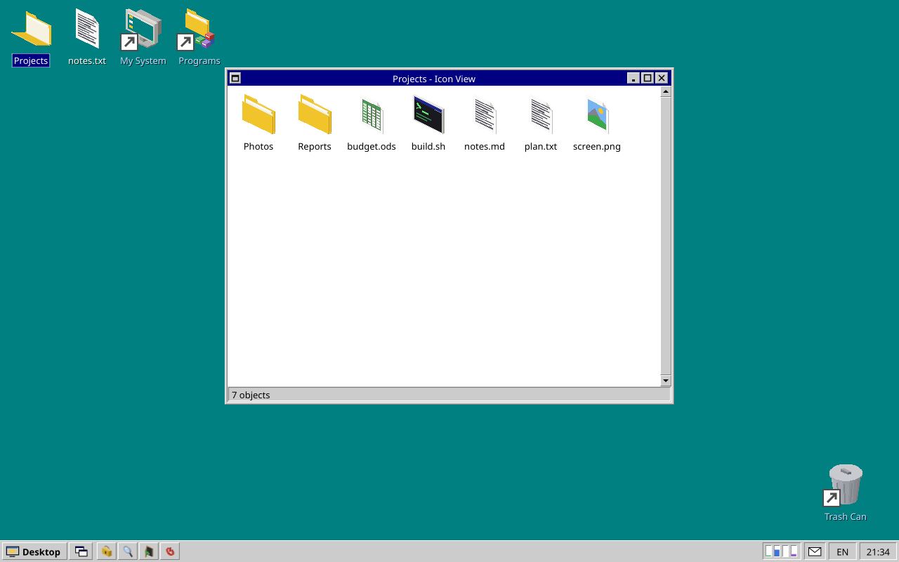
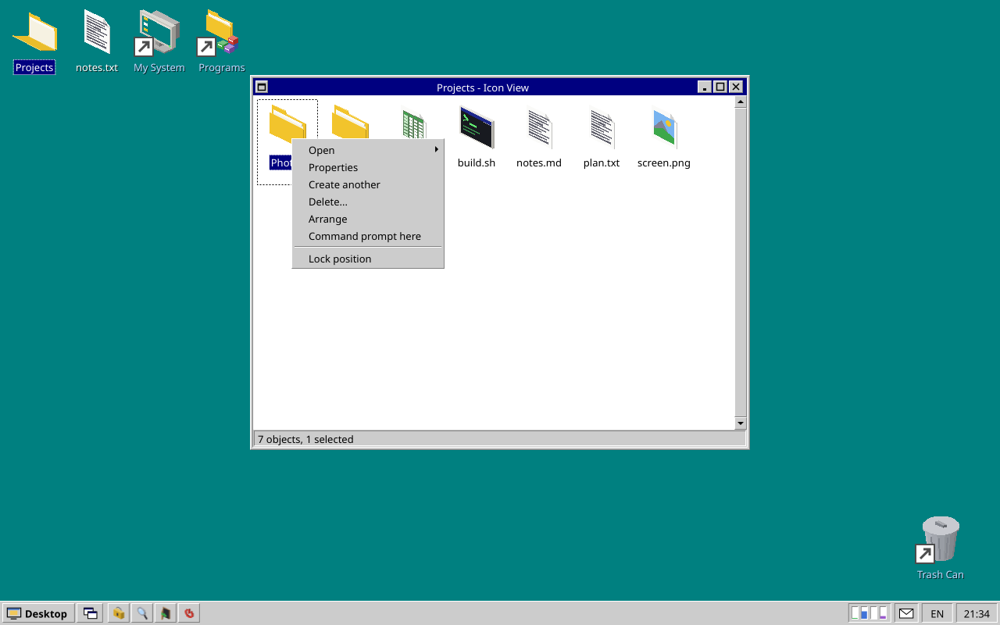
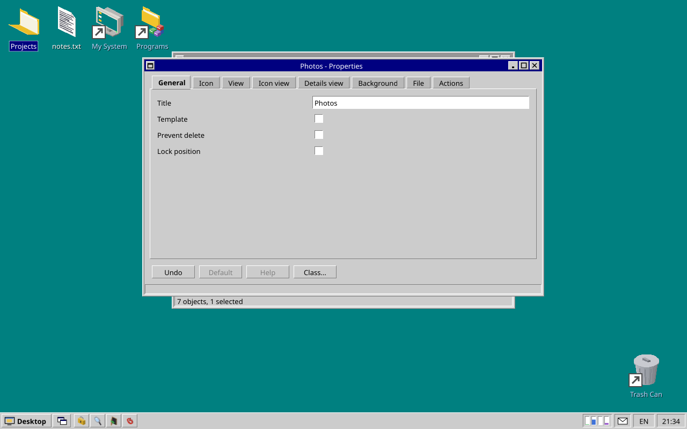

# Objectspace

**An object desktop for Linux, inspired by the Workplace Shell of OS/2.**

Every file, folder and program on the desktop is an object: it has a class, settings that stay with it when it is moved or copied, and a properties notebook. Objects can have shadows (links that follow them), templates make new ones, and a setting can be made for one object, for a file type, or for a whole class. Objectspace draws its own desktop, folder windows, menus and notebooks, and runs as its own Wayland session or as the desktop inside GNOME.

The aim is not to replicate the Workplace Shell as it was. Its object model and ways of working are the base; on them, Objectspace sets out to be useful on a modern Linux system: a Wayland session or the desktop inside GNOME, every other program's windows framed and listed, files changed by any program followed live, search, icon themes and sizes, high-resolution screens, input methods for every language, removable drives that carry their objects' settings, a terminal and a command for scripts. Where OS/2 had an answer, Objectspace starts from it; where today's systems need something OS/2 never had, it adds it in the same spirit.



| An object's menu | Its properties notebook |
|---|---|
|  |  |

OS/2 and Workplace Shell are trademarks of IBM. Objectspace is not affiliated with or endorsed by IBM, and uses no OS/2 code, pictures or sounds: it is a new implementation of the ideas, for Linux.

> **A note on the history.** Up to version 0.4.1 this project was private and named WPS (a Workplace Shell for Linux). 0.5, its first public version, took a name of its own for that reason. The older documents in `docs/` say WPS and use the old names; they are kept as they were written. See [docs/HISTORY.md](docs/HISTORY.md).

## What it does

- **Objects that last.** Titles, icons, positions and settings are kept with each file (in extended attributes) and in a per-user database, and follow it when it is moved, copied or renamed, by Objectspace or by any other program. Removable drives carry their objects' state with them.
- **Folders as OS/2 had them, and more.** Icon, tree and details views, a Column view (NeXT's browser) and a Gallery view; pictures shown in place of their icons; a menu bar (Alt); icons placed anywhere (OS/2's free layout) or arranged; whole titles; open icons and hatching; folder windows that remember their size, place and view; Work Area folders, whose windows open, minimize and close together.
- **Settings at every level.** Each setting is a property, looked up from the object, then its file type, its class and the classes above it, the scheme, and the default. **Class...** on any notebook opens the settings of all objects of that class.
- **Actions on events.** What happens when an object is opened, made, put in the Trash Can or deleted: a sound, a command, a method or settings.
- **The desktop's own objects.** My System (System Setup: schemes, fonts, sounds, the mouse, icon themes), the Trash Can, Drives, Programs (the installed programs), Startup, Templates, the Colour and Font Palettes, Messages, a Command Prompt.
- **TheBar** at the screen's edge: the desktop's menu, trays of objects (as WarpCenter had), the window list, programs, status icons, messages and the clock. A **Launcher** palette for favourite objects.
- **Its own session.** `osd-compositor` (on wlroots) runs the desktop with OS/2-style window frames for every program, a lock screen, idle handling and suspend; or the GNOME Shell extension puts the desktop inside GNOME.
- **Objectspace Terminal and the `osd` command**, for text-mode programs and for scripts that work with objects (as REXX did on OS/2).
- **A plug-in SDK** (`objectspace-devel`): new classes of objects, in C, run in a sandboxed host.

## Status

Version **0.6** is the current version (0.5 was the first public one). It runs on **Fedora 45 (x86_64)**, which is where it is built and tested; other distributions with wlroots 0.20 may work but are not tried. It is young software, used daily by its author, with known gaps listed in [docs/open-issues.md](docs/open-issues.md) and plans in [docs/roadmap.md](docs/roadmap.md).

## Installing

On Fedora 45, download the RPMs from the [latest release](https://github.com/sungsookhim/objectspace-desktop/releases/latest), then:

```
sudo dnf install ./objectspace-*.rpm
```

Reboot (the login screen reads its list of sessions at start), then choose **Objectspace** on the login screen. Or, to have the desktop inside GNOME, log in to GNOME and run `gnome-extensions enable objectspace@sungsookhim.github.io`, then log out and in.

To remove it: `sudo dnf remove objectspace objectspace-gnome-shell-extension objectspace-devel`. Your objects' state in `~/.local/share/objectspace` and `~/.config/objectspace` is kept.

## Building from source

The packages, on Fedora 45:

```
sudo dnf install gcc make git-core python3 python3-pillow sqlite-devel cairo-devel harfbuzz-devel \
    freetype-devel fontconfig-devel wayland-devel wayland-protocols-devel libxkbcommon-devel \
    pipewire-devel systemd-devel wlroots-devel pixman-devel libdrm-devel libxcb-devel \
    libsndfile-devel librsvg2-devel libvterm-devel zlib-devel pam-devel \
    xorg-x11-server-Xwayland glycin-thumbnailer xdg-user-dirs libasan libubsan
```

Then, in the checkout:

```
make && make gui && make session        # everything the session runs (after a pull, this again)
sudo tools/install-session.sh           # "Objectspace" on the login screen; then reboot
tools/install-extension.sh              # or: the desktop inside GNOME (and the osdd user service)
```

The session needs a real seat (a console, or a virtual machine's screen). To try it without logging out: `tools/try-compositor.sh` runs the compositor in a window of your session, and `tools/try-desktop.sh` a nested GNOME Shell with the extension (needs `mutter-devkit`).

`make rpm` builds the RPMs from a checkout (needs `rpm-build`); `make install DESTDIR=... PREFIX=/usr` installs into a staging root.

## Tests

```
make check          # unit tests, the service's scenarios, the strict C11 core check, the licence lines
make gui-test       # the widget set's unit tests
make comp-test      # the compositor and the desktop, headless, played by scripts
make install-check  # an install into a scratch root, run headless
make visual-baseline && make visual-check   # screenshots in each scheme, compared
```

`tests/gui/golden.sh OUT` runs every GUI self-test and `tests/gui/golden-compare.sh BASE OUT` compares two runs. The tests use AddressSanitizer and UBSan when `libasan` and `libubsan` are installed. Continuous integration runs the build and these tests on Fedora 45 for every push.

## Documents

| Document | What it holds |
|---|---|
| [docs/object-core-design.md](docs/object-core-design.md) | The object core: runtime, classes, identity, persistence, concurrency, change tracking, links, the service and its protocol |
| [docs/gui-design.md](docs/gui-design.md) | The GUI: OS/2 Warp 4 as the base, the widget set, coexisting with GNOME, the compositor |
| [docs/object-properties-design.md](docs/object-properties-design.md) | Settings as properties of objects, events and actions, plug-ins |
| [docs/cli-design.md](docs/cli-design.md) | Objectspace Terminal and the `osd` command |
| [docs/roadmap.md](docs/roadmap.md) | What is open, deferred or not yet designed, and the order proposed for it |
| [docs/open-issues.md](docs/open-issues.md) | Known problems and gaps |
| [docs/release-notes-0.6.md](docs/release-notes-0.6.md) | What 0.6 brings: TheBar's trays, a folder menu bar, Column and Gallery views, pictures for icons, suspend after idle |
| [docs/release-notes-0.5.md](docs/release-notes-0.5.md) | What 0.5 brings, and what is called what for those coming from WPS 0.4.1 |
| [docs/v0.6-design.md](docs/v0.6-design.md), [docs/v0.6-plan.md](docs/v0.6-plan.md) | 0.6's design and plan; the design's drafts for 0.7 (screens and themes) |
| [docs/HISTORY.md](docs/HISTORY.md) | The project's history, its old name, and the old names next to today's |
| `docs/v0.*-design.md`, `docs/v0.*-plan.md`, `docs/release-notes-*.md` | Each version's design, plan and release notes |
| [sdk/README.md](sdk/README.md) | Writing plug-ins |

## Layout

| Path | Contents |
|---|---|
| `runtime/` | The object runtime (`osdo.h`, `osdo.c`: C11, the C library only), the main loop and plug-in loading |
| `classes/` | The classes, each an `.osdi` interface file and its C |
| `tools/osdc.py` | Generates C bindings from `.osdi` files |
| `service/` | `osdd` (the per-user object service), `osdctl` and `osd` (its command-line clients), `osd-watchd` (an optional root helper for change tracking), `osd-plughost` (runs a plug-in, sandboxed) |
| `gui/` | The widget set (`gui/ui_*.c`), the desktop and folder windows (`gui/shell/`, `osd-shell`), Objectspace Terminal (`gui/terminal/`) |
| `compositor/` | `osd-compositor`, the session's Wayland compositor (wlroots) |
| `gnome-extension/` | The GNOME Shell extension that runs the desktop inside GNOME |
| `data/`, `packaging/` | Pictures, man pages, session and service files; the RPM spec |
| `sdk/` | The plug-in SDK and a sample plug-in |
| `tests/` | Unit tests, scenarios, headless compositor and GUI tests |
| `proto/` | The first prototypes (kernel behaviour, a folder window, sound latency) and their findings |

## Contributing

Issues and pull requests are welcome; see [CONTRIBUTING.md](CONTRIBUTING.md) for building, testing and the code's style. Everyone taking part follows the [Code of Conduct](CODE_OF_CONDUCT.md). To report a security problem, see [SECURITY.md](SECURITY.md).

## Authorship and license

This project started from fond memories of using OS/2, from Warp 3.0 through WSeB to eComStation, and of missing its Workplace Shell. The original design and ideas are OS/2's, from IBM; this is a new implementation of them for Linux, not affiliated with IBM or with the current owners of OS/2.

Objectspace is designed and built by Sungsoo Khim. Its code was written with the assistance of Claude (Anthropic's AI model) through Claude Code; the design, decisions and testing are the author's.

Released under the MIT License: see [LICENSE](LICENSE) and [NOTICE](NOTICE).
